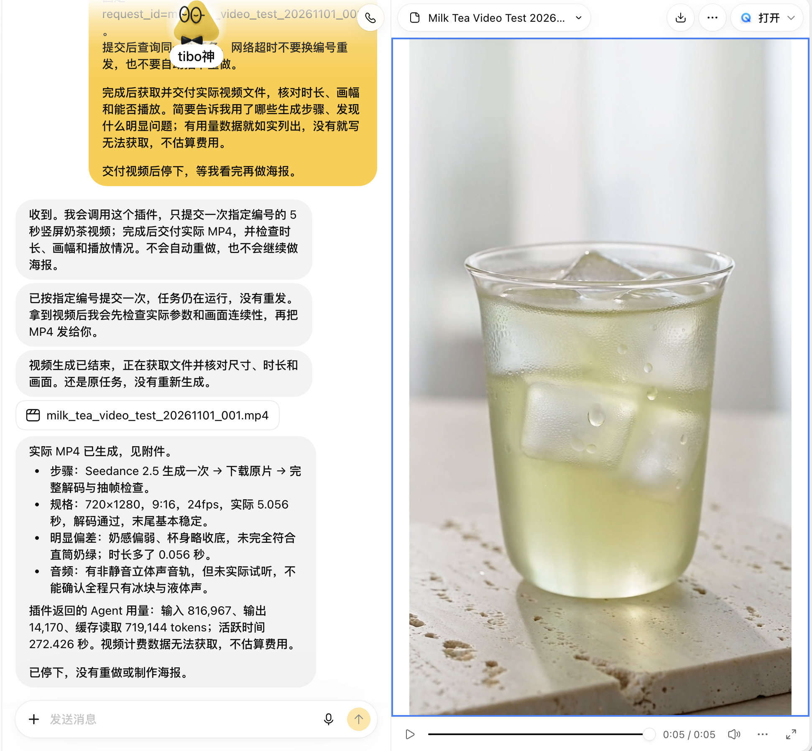
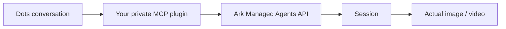

<div align="center">

[中文](./README.md) · **English** · [日本語](./README.ja.md)

# 🧋 Seedacne × Dots

#### Ask in Dots, and get real images and videos back from your own visual creation agent

[](https://github.com/LearnPrompt/seedacne-dots/actions/workflows/ci.yml)
[](./LICENSE)
[](#%EF%B8%8F-how-it-works)


</div>

This repo is a setup template for Codex to run. Send it the prompt below and it provisions your own Volcengine Ark agent, deploys a private MCP service only you can reach, and connects that service to OpenAI Dots. From then on you request work, check progress and collect results inside a Dots conversation.

Seedacne is this project's name for the **Seedance Managed Agent** on Volcengine Ark (火山方舟). The console, the API and the code identifiers all say Seedance. This is an unofficial example: the account, the key and the bill are yours. The repo holds no credentials and offers no shared service.

<table>
<tr>
<td width="36%" align="center">
<a href="assets/milk-tea-5s.mp4"></a>
<br><sub>The delivered video. Click for the original MP4.</sub>
</td>
<td align="center">
<a href="assets/dots-conversation.png"></a>
<br><sub>The real Dots conversation and delivery receipt (Chinese)</sub>
</td>
</tr>
</table>

---

## 📦 Install

Use a Codex that has a terminal, a browser or computer use, and send this:

```text
Follow AGENTS.md and docs/setup-prompt.md in https://github.com/LearnPrompt/seedacne-dots and actually set up my own Seedacne Managed Agent (shown as Seedance Managed Agent in the Volcengine Ark console), connected to OpenAI Dots through a private Sites MCP.
First check the current official docs, the available tools and my account permissions, and reuse this repo's source. Carry on with the necessary checks, development, private deployment and read-only verification. Collect everything that really needs me into one list, and do not ask again about anything already authorized within the same scope.
By default, do not submit any generation, top up, or buy services. Finish all the integration work that costs no generation fees first, then give me a concrete plan and authorization point for one 5-second video test.
```

To see what Codex will follow, read the [full setup prompt](docs/setup-prompt.md) or its [plain-text version](docs/setup-prompt.txt) (both in Chinese; Codex reads them fine).

---

## ✅ Before you start

Every item here is required. It is worth a minute now.

| You need | Requirement | Official docs |
|---|---|---|
| **OpenAI Dots** | Pro 100 / 200 / 500 (18+, outside the EEA, UK and Switzerland), Business Premium, or Enterprise with an admin enabling it. Rolling out gradually, so eligible accounts may not see it yet | [Dots](https://learn.chatgpt.com/docs/dots) |
| **Sites** | Able to create a private site and generate its private MCP plugin. The template relies on the Sites auth gateway | [Sites](https://learn.chatgpt.com/docs/sites) |
| **Volcengine Ark account** | Able to create a Seedance Managed Agent. Available models depend on the console's creation page. Generation is billed by usage | [Visual creation agent (Chinese)](https://docs.volcengine.com/docs/ark/visual-creation-agent?lang=zh) |
| **Codex** | With terminal and browser access, or computer use | [Plugin quickstart](https://developers.openai.com/plugins/quickstart) |

---

## 🧭 What happens next

**Step 1: Codex does the work.** It checks your eligibility, creates or reuses the agent and cloud environment, and deploys the private MCP with generation switched off.

**Step 2: you approve what only you can.** You are needed only for signing in and verification codes, accepting specific service terms, creating a dedicated key and storing it in the private service, confirming new plugin permissions, and paying or running the first paid generation. The [authorization checklist](docs/authorizations.md) (Chinese) lists what to confirm for each, with replies you can copy.

**Step 3: test in Dots.** Start with a read-only connection check that reads your own agent and environment. After you explicitly authorize it, submit one test, keep querying with the same `request_id`, then download the actual MP4 and check its specs and picture. Do not switch IDs after a timeout, or you risk paying twice.

A ready-made test prompt is in the [demo write-up](docs/demo.md) (Chinese).

---

## 🧋 One real run

A single 5-second milk tea video, from the Dots request to the delivered MP4, with no regeneration.

| Item | Result |
|---|---|
| Specs | 720 × 1280 (9:16), H.264, 24 fps, 121 frames, 5.056 s |
| Audio | AAC 32 kHz stereo. The track is not silent; nobody has listened to it |
| Task status | `end_turn`, no tool errors, the MP4 decodes fully |
| Missed the brief | Too little milkiness, and the cup tapers slightly instead of being a straight tumbler |
| Agent usage | 816,967 input / 14,170 output / 719,144 cache-read tokens, 272 s active |
| Video cost | No billing detail available. The tokens above are not the bill |

**Getting a video and meeting the brief are two separate checks.** One task may call several models and tools, the template has no hard spending cap, and a submission has no fixed price.

Full measurements and SHA-256 hashes are in the [demo write-up](docs/demo.md) and [media metadata](assets/media-metadata.json).

---

## ⚙️ How it works



| MCP tool | What it does | Cost |
|---|---|---|
| `seedance_connection_status` | Checks config; with `verify_remote=true`, reads your agent and environment | No generation |
| `seedance_create_task` | Submits one task, deduplicated durably in D1 by `request_id` | **Paid** |
| `seedance_get_task` | Reads the original task's status, stop reason, tool errors and latest messages | No generation |
| `seedance_get_outputs` | Lists registered outputs with time-limited download URLs | No generation |

---

## 🚧 Limits

- **Sites only.** The template trusts the gateway-injected `oai-authenticated-user-id` header, which we could not find in public docs. Any other platform needs equivalent authentication and user isolation. Deployed straight to the public internet, identities can be forged.
- **Beijing region only.** It defaults to the Ark China Beijing API. Other regions are unverified, and changing the domain is not enough.
- **Text input only.** You can submit tasks, read status and fetch outputs. Reference uploads, session continuation and multi-round editing are not built.
- **No way forward from `requires_action`.** The tool reports it honestly, and you follow up in Ark yourself.
- **12,000-character prompt limit.** Anything longer is rejected without submitting a task.

---

## 🔬 Develop and verify

Requires Node.js 24 or later, with no third-party runtime dependencies.

```sh
npm run check
```

This runs 13 offline tests, the build, an artifact check, and a relative-link and privacy scan. It never contacts Ark or generates anything.

| Config | Purpose |
|---|---|
| `ARK_API_KEY` | Server-side secret only. Never in source, logs, screenshots, tool arguments or the frontend |
| `ARK_AGENT_ID` / `ARK_ENVIRONMENT_ID` | Real resources from your own account |
| `GENERATION_ENABLED` | Starts as `false`. Turn on only after read-only checks pass and you authorize it |
| `DB` | Sites D1 binding. Apply `drizzle/0000_jobs.sql` on deployment |

Local checks, read-only online checks, a real Dots generation and output quality are four independent results. Passing one says nothing about the next.

For a personal instance, copy the template to a separate folder without `.git`, build output or credentials. Never push personal deployment config back to this public repo.

---

## 📚 Docs

All in Chinese for now.

| Doc | Contents |
|---|---|
| [Setup prompt](docs/setup-prompt.md) | The complete flow to give Codex |
| [Authorization checklist](docs/authorizations.md) | Each step that needs you, with replies to copy |
| [Demo write-up](docs/demo.md) | Test prompt, measurements and known deviations |
| [Troubleshooting](docs/troubleshooting.md) | Symptoms and next steps. Keep the original `request_id` first |
| [AGENTS.md](AGENTS.md) | For the Codex taking over this repo |

---

## 🌟 Acknowledgements

The setup flow is based on the official [Ark visual creation agent](https://docs.volcengine.com/docs/ark/visual-creation-agent?lang=zh), [Dots](https://learn.chatgpt.com/docs/dots), [Sites](https://learn.chatgpt.com/docs/sites) and [MCP server](https://developers.openai.com/plugins/build/mcp-server) docs. The README layout takes after [khazix-skills](https://github.com/KKKKhazix/khazix-skills).

---

<div align="center">

Code under [MIT](./LICENSE) · media in [assets](assets/README.md) is not covered by MIT

Made by [@LearnPrompt](https://github.com/LearnPrompt)

</div>
