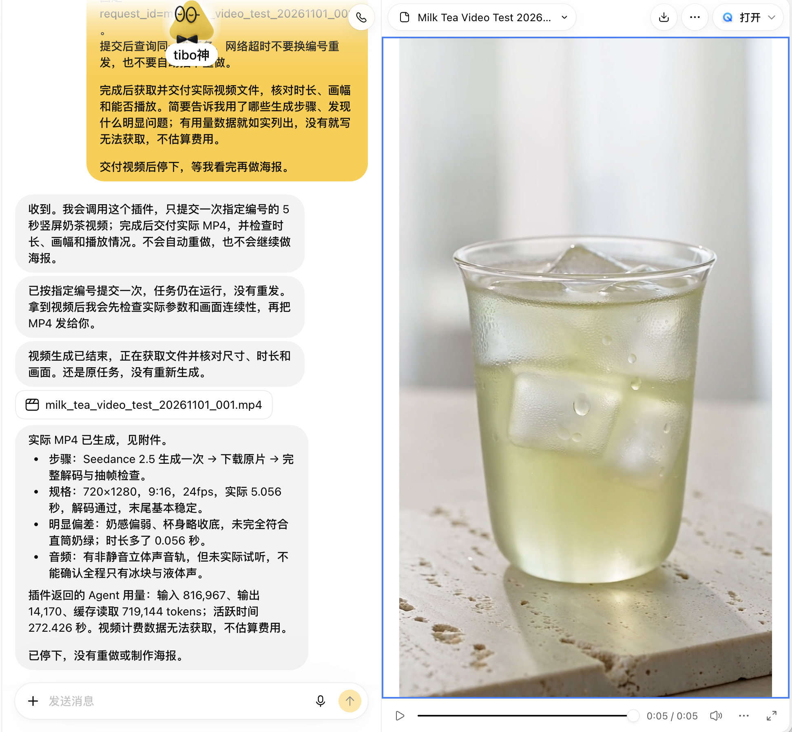
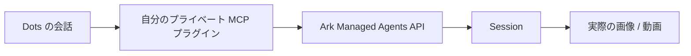

<div align="center">

[中文](./README.md) · [English](./README.en.md) · **日本語**

# 🧋 Seedacne × Dots

#### Dots で頼むだけ。自分のビジュアル制作エージェントが本物の画像と動画を返してくれる

[](https://github.com/LearnPrompt/seedacne-dots/actions/workflows/ci.yml)
[](./LICENSE)
[](#%EF%B8%8F-仕組み)


</div>

このリポジトリは、Codex に実行してもらう接続テンプレートです。下のプロンプトを Codex に送ると、あなた自身の Volcengine Ark（火山方舟）エージェントを用意し、あなただけがアクセスできるプライベート MCP サービスをデプロイして、OpenAI Dots につなぎます。あとは Dots の会話で依頼し、参考画像を添えたり同じセッションで修正を重ねたりしながら、成果物を受け取るだけです。

Seedacne は、Volcengine Ark の **Seedance Managed Agent** に対するこのプロジェクトでの呼び名です。コンソール、API、コード上の識別子はすべて Seedance です。これは非公式のサンプルで、アカウント、キー、費用はすべてご自身のものです。リポジトリに認証情報は含まれず、共用サービスも提供していません。

<table>
<tr>
<td width="36%" align="center">
<a href="assets/milk-tea-5s.mp4"></a>
<br><sub>実際に納品された動画。クリックで元の MP4 へ</sub>
</td>
<td align="center">
<a href="assets/dots-conversation.png"></a>
<br><sub>Dots での実際の会話と納品レポート（中国語）</sub>
</td>
</tr>
</table>

---

## 📦 インストール

ターミナル、ブラウザ、または computer use が使える Codex に、次の文章を送ってください。

```text
https://github.com/LearnPrompt/seedacne-dots の AGENTS.md と docs/setup-prompt.md に従って、私自身の Seedacne Managed Agent（Volcengine Ark のコンソールでは Seedance Managed Agent と表示）を実際に設定し、プライベート Sites MCP 経由で OpenAI Dots に接続してください。
まず現在の公式ドキュメント、使えるツール、私のアカウント権限を確認し、このリポジトリのソースを再利用してください。必要な確認、開発、プライベートデプロイ、読み取り専用の検証は続けて進めてください。本当に私の操作や承認が必要な項目は一か所にまとめ、同じ範囲で承認済みの操作は聞き直さないでください。
デフォルトでは素材の生成、チャージ、サービス購入は行わないでください。生成費用のかからない接続作業を先に終わらせてから、5 秒動画テスト 1 回の具体的なプランと承認ポイントを提示してください。
```

Codex が何に沿って動くかは、[セットアッププロンプト全文](docs/setup-prompt.md)または[プレーンテキスト版](docs/setup-prompt.txt)で確認できます（どちらも中国語ですが、Codex はそのまま読めます）。

---

## ✅ 始める前に

どれか一つでも欠けると接続できません。先に確認しておくのがおすすめです。

| 必要なもの | 条件 | 公式ドキュメント |
|---|---|---|
| **OpenAI Dots** | Pro 100 / 200 / 500（18 歳以上、EEA・英国・スイスを除く）、Business Premium（ワークスペースの資格による）、対象となる Enterprise・Edu・Healthcare ワークスペース（UAE のデータ／推論レジデンシーを除く。2026 年 11 月 18 日からは既定で有効、それまでは管理者がロールごとに有効化）。段階的に提供中のため、対象でもまだ表示されない場合があります | [Dots](https://learn.chatgpt.com/docs/dots) |
| **Sites** | プライベートサイトを作成し、プライベート MCP プラグインを生成できること。テンプレートは Sites の認証ゲートウェイに依存します | [Sites](https://learn.chatgpt.com/docs/sites) |
| **Volcengine Ark アカウント** | Seedance Managed Agent を作成できること。選べるモデルはコンソールの作成画面によります。生成は従量課金です | [ビジュアル制作エージェント（中国語）](https://docs.volcengine.com/docs/ark/visual-creation-agent?lang=zh) |
| **Codex** | ターミナルとブラウザ、または computer use が使えること | [プラグインクイックスタート](https://developers.openai.com/plugins/quickstart) |

---

## 🧭 このあとの流れ

**ステップ 1：Codex が作業します。** 利用資格を確認し、エージェントとクラウド環境を作成または再利用して、生成をオフにした状態でプライベート MCP をデプロイします。

**ステップ 2：あなたにしかできない承認をします。** 必要になるのは次の場面だけです。本人のログインと認証コード、具体的なサービス規約への同意、専用キーの作成とプライベートサービスへの保存、プラグインの新しい権限の確認、支払いまたは初回の有料生成。確認内容とコピーして使える返信は[承認チェックリスト](docs/authorizations.md)（中国語）にあります。

**ステップ 3：Dots で実際に試します。** まず読み取り専用の接続チェックで、自分のエージェントと環境が読めることを確認します。明示的に承認したあとでテストを 1 回送信し、同じ `request_id` で問い合わせを続け、実際の MP4 をダウンロードして仕様と映像を確認します。タイムアウトしても ID を変えて再送しないでください。二重に課金されるおそれがあります。

テスト用プロンプトは[実測レポート](docs/demo.md)（中国語）にあります。`request_id` は自分用の新しい ID に置き換えて使ってください。

---

## 🧋 実際に 1 回動かした結果

5 秒のミルクティー動画を 1 本、Dots からの依頼から MP4 の受け取りまで、再生成なしで完了しました。

| 項目 | 結果 |
|---|---|
| 仕様 | 720 × 1280（9:16）、H.264、24 fps、121 フレーム、5.056 秒 |
| 音声 | AAC 32 kHz ステレオ。無音ではありませんが、人の耳では未確認です |
| タスク状態 | `end_turn`、ツールエラーなし、MP4 は完全にデコード可能 |
| 要件を満たさなかった点 | ミルク感が弱く、カップがわずかに底すぼまりで、ストレートグラスのグリーンミルクティーになりきっていません |
| エージェント使用量 | 入力 816,967 / 出力 14,170 / キャッシュ読み取り 719,144 トークン、稼働 272 秒 |
| 動画の費用 | 請求明細は取得できず。上記のトークン数は請求額ではありません |

**動画が手に入ることと、映像が要件を満たすことは別の検証です。** 1 つのタスクで複数のモデルやツールが呼ばれることがあり、テンプレートに金額の上限はなく、1 回の送信が固定料金になるわけでもありません。

詳しい測定値と SHA-256 は[実測レポート](docs/demo.md)と[メディアメタデータ](assets/media-metadata.json)を参照してください。

v0.2 では参考画像のアップロードと、同じ Session での 1 回の追加修正も実際に検証しました。この修正はコードによるマスク処理で、生成系の画像モデルは使っていません。確認できたのは継続の経路が動くことまでで、画質にはまだ課題があります。詳しくは[検証記録](docs/validation-v0.2.md)（中国語）をご覧ください。

---

## ⚙️ 仕組み



| MCP ツール | 内容 | 費用 |
|---|---|---|
| `seedance_connection_status` | 設定を確認。`verify_remote=true` で自分のエージェントと環境を読み取り | 生成なし |
| `seedance_upload_reference` | Dots で添付した画像を Ark へアップロード。`reference_id` で重複防止 | 生成なし |
| `seedance_get_reference` | 参考画像のアップロード状態を取得 | 生成なし |
| `seedance_create_task` | タスクを新規作成。`reference_ids` も指定可。`request_id` で D1 に永続的に重複防止 | **有料** |
| `seedance_continue_task` | 元の Session で修正を 1 ラウンド追加。毎回新しい `turn_id` を使う | **有料** |
| `seedance_get_task` | 指定ラウンド（既定は最新）の状態、停止理由、ツールエラーを取得 | 生成なし |
| `seedance_get_outputs` | 指定ラウンドの成果物と有効期限付きダウンロード URL を取得。古いファイルは新しい結果として扱わない | 生成なし |

---

## 🚧 制限事項

- **Sites 専用です。** テンプレートはゲートウェイが付与する `oai-authenticated-user-id` ヘッダーを信頼しますが、このヘッダーは公開ドキュメントで確認できていません。他のプラットフォームでは同等の認証とユーザー分離が必要で、そのまま公開すると ID を偽装できてしまいます。
- **北京リージョンのみ検証済みです。** 接続先は Ark の中国・北京 API に固定されています。他のリージョンは未検証で、ドメインを変えるだけでは動きません。
- **参考画像は JPEG、PNG、WebP のみです。** 1 枚 10 MiB まで、1 ラウンド 6 枚まで。音声や動画の参考素材、尺や解像度の専用パラメーターは未実装です。最初のアップロードはブロックされ、ダウンロード元のホスト名が表示されます。確認してから `REFERENCE_ALLOWED_HOSTS` に追加してください。
- **`requires_action` で止まると先に進めません。** ツールはそのまま報告するので、続きは Ark 側で調べてください。
- **プロンプトは 12,000 文字まで。** 超えるとタスクは送信されません。

---

## 🔬 開発と検証

Node.js 24 以上が必要です。サードパーティの実行時依存はありません。

```sh
npm run check
```

すべてのオフラインテスト、ビルド、成果物チェック、相対リンクとプライバシーのスキャンを実行します。Ark にはアクセスせず、素材も生成しません。

| 設定 | 用途 |
|---|---|
| `ARK_API_KEY` | サーバー側のシークレットのみ。ソース、ログ、スクリーンショット、ツール引数、フロントエンドには入れない |
| `ARK_AGENT_ID` / `ARK_ENVIRONMENT_ID` | 自分のアカウントの実リソース |
| `GENERATION_ENABLED` | 初期値は `false`。読み取り検証に通り、承認したあとで有効化 |
| `REFERENCE_ALLOWED_HOSTS` | 参考画像の一時ダウンロード URL の正確なホスト名（カンマ区切り）。初期値は空で、実際の取得元を確認してから設定。署名付き URL 全体は入れない |
| `DB` | Sites の D1 バインディング。デプロイ時に `drizzle/` のマイグレーションを順にすべて適用し、既存のタスクは残す |

ローカルチェック、オンラインの読み取り検証、Dots での実際の生成、素材の品質は、それぞれ独立した結果です。一つ通っても次が通るとは限りません。

個人用インスタンスを作るときは、`.git`、ビルド成果物、認証情報を除いて別のフォルダへコピーしてください。個人のデプロイ設定をこの公開リポジトリへ push しないでください。

---

## 📚 ドキュメント

現在はすべて中国語です。

| ドキュメント | 内容 |
|---|---|
| [セットアッププロンプト](docs/setup-prompt.md) | Codex に渡す全手順 |
| [承認チェックリスト](docs/authorizations.md) | 本人の確認が必要な場面と、コピーできる返信 |
| [実測レポート](docs/demo.md) | テストプロンプト、測定結果、既知のずれ |
| [トラブルシューティング](docs/troubleshooting.md) | 症状と次の手順。まず元の `request_id` を保持 |
| [参考画像と複数ラウンドの修正](docs/references-and-turns.md) | v0.2 のアップロード、マウント、同一セッションでの修正手順 |
| [検証記録](docs/validation-v0.2.md) | v0.2 の各レイヤーの実際の検証結果 |
| [変更履歴](CHANGELOG.md) | バージョンごとの変更とアップグレード時の注意 |
| [AGENTS.md](AGENTS.md) | このリポジトリを引き継ぐ Codex 向け |

---

## 🌟 謝辞

接続手順は、公式の [Ark ビジュアル制作エージェント](https://docs.volcengine.com/docs/ark/visual-creation-agent?lang=zh)、[Dots](https://learn.chatgpt.com/docs/dots)、[Sites](https://learn.chatgpt.com/docs/sites)、[MCP サーバー](https://developers.openai.com/plugins/build/mcp-server)のドキュメントに基づいています。README のレイアウトは [khazix-skills](https://github.com/KKKKhazix/khazix-skills) を参考にしました。

---

<div align="center">

コードは [MIT](./LICENSE) · [assets](assets/README.md) 内のメディアは MIT の対象外です

Made by [@LearnPrompt](https://github.com/LearnPrompt)

</div>
