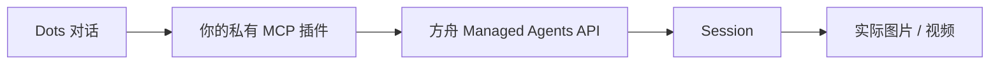

<div align="center">

**中文** · [English](./README.en.md) · [日本語](./README.ja.md)

# 🧋 Seedacne × Dots

#### 在 Dots 里说一句需求，让你自己的视觉创作 Agent 交回真实的图片和视频

[](https://github.com/LearnPrompt/seedacne-dots/actions/workflows/ci.yml)
[](./LICENSE)
[](#%EF%B8%8F-工作原理)


</div>

这个仓库是一份交给 Codex 执行的接入模板。把下面那段话发给 Codex，它会帮你开好自己的火山方舟 Agent，部署一个只有你能访问的私有 MCP 服务，再把它接进 OpenAI Dots。之后你在 Dots 对话里提需求、附参考图、在原会话里接着改，再拿回成品。

Seedacne 是本项目对火山方舟 **Seedance Managed Agent** 的叫法，控制台、API 和代码标识里看到的都是 Seedance。这是非官方示例，账号、Key、费用都是你自己的，仓库里不含任何人的凭据，也不提供共用服务。

<table>
<tr>
<td width="36%" align="center">
<a href="assets/milk-tea-5s.mp4"></a>
<br><sub>实际交付的视频，点开看原始 MP4</sub>
</td>
<td align="center">
<a href="assets/dots-conversation.png"></a>
<br><sub>Dots 里的真实对话与交付回执</sub>
</td>
</tr>
</table>

---

## 📦 安装

用有终端、浏览器或 computer use 能力的 Codex，发这段话：

```text
请按 https://github.com/LearnPrompt/seedacne-dots 的 AGENTS.md 和 docs/setup-prompt.md，实际帮我配置我自己的 Seedacne Managed Agent，并通过私有 Sites MCP 接入 OpenAI Dots。
先检查当前官方文档、可用工具和我的账号权限，复用本仓库源码。继续完成必要的检查、开发、私有部署和只读验证；把确实需要本人操作或授权的事项集中标出，已授权同一范围的动作不要重复询问。
默认不提交素材生成、不充值或购买服务。先把不花生成费的接入工作做完，再给我一次 5 秒视频测试的具体方案与授权点。
```

想看 Codex 会照着做什么，读[完整接入提示词](docs/setup-prompt.md)，也有[纯文本版](docs/setup-prompt.txt)。

---

## ✅ 开始前确认

这几样缺一样都接不通，建议先花一分钟看完。

| 需要 | 要求 | 官方说明 |
|---|---|---|
| **OpenAI Dots** | Pro 100 / 200 / 500（18 岁以上，不含欧洲经济区、英国、瑞士），Business Premium，或由管理员开启的 Enterprise。正在逐步开放，符合条件也可能暂时看不到 | [Dots 文档](https://learn.chatgpt.com/docs/dots) |
| **Sites** | 能创建私有站点并生成私有 MCP 插件。模板依赖它的鉴权网关 | [Sites 文档](https://learn.chatgpt.com/docs/sites) |
| **火山方舟账号** | 能创建 Seedance Managed Agent。可选模型以控制台创建页为准，生成按量计费 | [视觉创作 Agent 文档](https://docs.volcengine.com/docs/ark/visual-creation-agent?lang=zh) |
| **Codex** | 能操作终端和浏览器，或有 computer use | [插件快速开始](https://developers.openai.com/plugins/quickstart) |

---

## 🧭 接下来会发生什么

**第一步，Codex 干活。** 它检查账号资格，创建或复用 Agent 和云端 Environment，部署私有 MCP，这时生成开关默认是关的。

**第二步，你点头。** 只有碰到这些才需要你：本人登录和验证码、接受具体服务协议、创建专用 Key 并写入私有服务、确认插件新增权限、付款或首次付费生成。每项确认什么、怎么回复，都在[授权清单](docs/authorizations.md)里。

**第三步，在 Dots 实测。** 先做只读连接检查，确认读得到你自己的 Agent 和 Environment。你明确授权后再提交一次测试，保持同一个 `request_id` 查询，下载实际 MP4 检查参数和画面。超时也不换编号重发，否则可能重复扣费。

测试提示词可以直接抄[案例文档](docs/demo.md)里的版本。

---

## 🧋 真实跑了一次

一次 5 秒奶茶视频，从 Dots 提交到收到 MP4，全程没有重新生成。

| 项目 | 结果 |
|---|---|
| 规格 | 720 × 1280（9:16），H.264，24 fps，121 帧，时长 5.056 秒 |
| 音频 | AAC 32 kHz 双声道，音轨非静音，未人工试听 |
| 任务状态 | `end_turn`，无工具错误，MP4 可完整解码 |
| 不达标处 | 奶感偏弱，杯身略收底，没有完全符合直筒奶绿的要求 |
| Agent 用量 | 输入 816,967 / 输出 14,170 / 缓存读取 719,144 tokens，活跃 272 秒 |
| 视频费用 | 未取得计费明细，上面的 tokens 不等于账单 |

**拿到视频和画面达标是两件事，要分开验收。** 一次任务可能调用多个模型和工具，模板没有金额硬上限，一次提交也不是固定总价。

完整测量和 SHA-256 见[实测案例](docs/demo.md)与[媒体元数据](assets/media-metadata.json)。

v0.2 另外实测了参考图上传，以及在同一个 Session 里的两轮真实修改，功能都已验收，图片质量仍有偏差，见[验证记录](docs/validation-v0.2.md)。

---

## ⚙️ 工作原理



| MCP 工具 | 做什么 | 费用 |
|---|---|---|
| `seedance_connection_status` | 检查配置；`verify_remote=true` 时只读查询你的 Agent 和 Environment | 不生成 |
| `seedance_upload_reference` | 把你在 Dots 里附的图上传到方舟，用 `reference_id` 防重 | 不生成 |
| `seedance_get_reference` | 查参考图的上传状态 | 不生成 |
| `seedance_create_task` | 新建任务，可带 `reference_ids`，用 `request_id` 在 D1 里持久防重 | **付费** |
| `seedance_continue_task` | 在原 Session 里接着改一轮，每轮用新的 `turn_id` | **付费** |
| `seedance_get_task` | 查指定轮（默认最新一轮）的状态、停止原因和工具错误 | 不生成 |
| `seedance_get_outputs` | 取指定轮的产物和有时效的下载地址，旧文件不算新结果 | 不生成 |

---

## 🚧 边界

- **只能跑在 Sites 上。** 模板信任网关注入的 `oai-authenticated-user-id`，这个请求头目前查不到公开文档。换平台必须自己实现等价的认证和用户隔离，直接部署到公网，身份可以被伪造。
- **只有北京地域验证过。** 默认使用方舟中国北京 API，换地域不是改个域名的事。
- **参考图只收 JPEG、PNG、WebP。** 单图最多 10 MiB，每轮最多 6 张；音频、视频参考和独立的时长、分辨率参数还没做。首次传图会被拦截并显示下载域名，核验后加进 `REFERENCE_ALLOWED_HOSTS`。
- **Agent 停在 `requires_action` 时无法接着处理。** 工具会如实报告，后续要自己去方舟排查。
- **单次提示词上限 12,000 字。** 超过时任务不会提交。

---

## 🔬 开发与验证

需要 Node.js 24 或更高版本，没有第三方运行依赖。

```sh
npm run check
```

这条命令跑全部离线测试、构建、产物检查、相对链接与隐私扫描，不访问方舟，也不生成素材。

| 配置 | 用途 |
|---|---|
| `ARK_API_KEY` | 只放服务端秘密变量，不进源码、日志、截图、工具参数或前端 |
| `ARK_AGENT_ID` / `ARK_ENVIRONMENT_ID` | 你自己账号里的真实资源 |
| `GENERATION_ENABLED` | 初始为 `false`，只读验证通过并授权后才打开 |
| `REFERENCE_ALLOWED_HOSTS` | 参考图临时下载地址的精确主机名，逗号分隔。初始留空，核验真实来源后再填，不能填完整签名 URL |
| `DB` | Sites D1 绑定，部署时按顺序应用 `drizzle/` 里的全部迁移，保留已有任务 |

本地通过、线上只读通过、Dots 实际生成、素材质量，是四项独立的结果，一项通过不代表下一项也过了。

创建个人实例时，复制到独立目录，排除 `.git`、构建产物和凭据。个人部署配置不要推回这个公开仓库。

---

## 📚 文档

| 文档 | 内容 |
|---|---|
| [从零接入提示词](docs/setup-prompt.md) | 发给 Codex 的完整流程 |
| [授权清单](docs/authorizations.md) | 每个需要本人确认的环节，附可复制回复 |
| [实测案例](docs/demo.md) | 测试提示词、测量结果和已知偏差 |
| [排障说明](docs/troubleshooting.md) | 常见现象和下一步，先保住原 `request_id` |
| [参考图与多轮修改](docs/references-and-turns.md) | v0.2 的上传、挂载和原会话续改步骤 |
| [验证记录](docs/validation-v0.2.md) | v0.2 每一层的实际验证结果 |
| [变更记录](CHANGELOG.md) | 版本变化与升级注意事项 |
| [AGENTS.md](AGENTS.md) | 写给接手这个仓库的 Codex |

---

## 🌟 致谢

接入流程基于官方的[方舟视觉创作 Agent](https://docs.volcengine.com/docs/ark/visual-creation-agent?lang=zh)、[Dots](https://learn.chatgpt.com/docs/dots)、[Sites](https://learn.chatgpt.com/docs/sites) 和 [MCP 服务](https://developers.openai.com/plugins/build/mcp-server)文档。README 版式参考了 [khazix-skills](https://github.com/KKKKhazix/khazix-skills)。

---

<div align="center">

代码 [MIT](./LICENSE) · [assets](assets/README.md) 里的媒体不在 MIT 范围内

Made by [@LearnPrompt](https://github.com/LearnPrompt)

</div>
