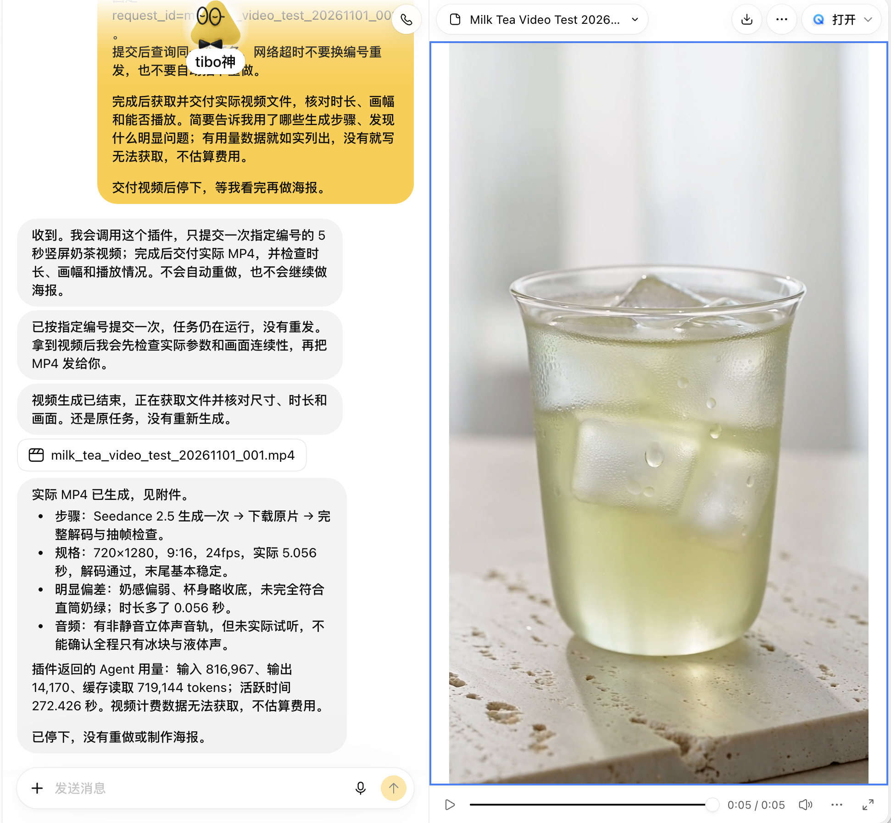

# Seedacne Managed Agent × Dots

把自己的火山方舟视觉创作 Agent 接入 OpenAI Dots，在对话里提交需求、查询进度、取得图片或视频。本项目提供可交给 Codex 执行的配置提示词、私有 MCP 源码和一次真实视频案例。

**三步上手：把仓库链接发给 Codex → 完成本人必要授权 → 在 Dots 实测。** 这是非官方接入示例；需要自己的方舟账号，以及可用的 Sites 私有 MCP 和 Dots 插件能力。开通资格、模型与界面以当前账号为准，实际创作按量计费。

## 1. 把这段话发给 Codex

```text
请按 https://github.com/LearnPrompt/seedacne-dots 的 AGENTS.md 和 docs/setup-prompt.md，实际帮我配置我自己的 Seedacne Managed Agent，并通过私有 Sites MCP 接入 OpenAI Dots。
先检查当前官方文档、可用工具和我的账号权限，复用本仓库源码。继续完成必要的检查、开发、私有部署和只读验证；把确实需要本人操作或授权的事项集中标出，已授权同一范围的动作不要重复询问。
默认不提交素材生成、不充值或购买服务。先把不花生成费的接入工作做完，再给我一次 5 秒视频测试的具体方案与授权点。
```

使用有终端、浏览器或 computer use 能力的 Codex。完整流程见 [从零接入提示词](docs/setup-prompt.md)，也可复制 [纯文本版本](docs/setup-prompt.txt)。这里的 Dots 指 OpenAI Dots；本机 Codex MCP 配置成功，不代表云端 Dots 已连接。

## 2. 完成本人必要授权

只在实际遇到时处理：本人登录/验证码、接受具体服务协议、创建专用 Key 并写入指定私有服务、确认插件新增权限，以及付款或首次付费生成。

每项的触发条件、确认内容和可复制回复见 [授权清单](docs/authorizations.md)。Codex 应先准备好具体对象再请求确认；独立的开发与检查继续进行。**本仓库不包含任何人的凭据，也不提供可共用的付费服务。**

## 3. 在 Dots 实测

先通过已安装的私有插件完成只读连接检查，确认能读到自己的 Agent 和 Environment；本人明确授权后再提交一次测试。保持同一 `request_id` 查询原任务，下载实际 MP4 并检查参数和画面，超时不换号重发。

下方为一次实际交付的对话截图。视频拿到了，但奶感偏弱、杯身略收底，没有完全符合直筒奶绿的要求。**链路跑通和视觉达标要分别验收。**

[](assets/dots-conversation.png)

[](assets/milk-tea-5s.mp4)

**[下载 / 查看实际 MP4](assets/milk-tea-5s.mp4)** · [测试提示词、测量结果与已知偏差](docs/demo.md)

## 接入方式与边界

```text
Dots → 自己的私有 MCP 插件 → 方舟 Managed Agents API → Session → 实际文件
```

- 模板依赖 **Sites 鉴权网关**及其注入的可信 `oai-authenticated-user-id`。不能原样部署成其他平台的公共服务；其他平台必须实现等价的认证、授权和用户隔离。
- 默认使用方舟中国北京 API；其他地域未验证，不能只换域名就视作支持。
- 当前支持**文字需求创建任务、查询状态、获取产物**。参考素材上传/挂载、会话续接与多轮编辑尚未实现。
- 一次 Managed Agent 任务可能包含多次模型或工具调用；一次提交不是固定总价，也不构成费用硬上限。
- 使用名称 Seedacne；控制台及 API 可能使用 Seedance，代码标识按官方实际名称保留。

## 源码配置与验证

| 配置 | 用途 |
|---|---|
| `ARK_API_KEY` | 仅放服务端秘密变量；不得进入源码、日志、截图、工具参数或前端 |
| `ARK_AGENT_ID` / `ARK_ENVIRONMENT_ID` | 自己账号创建或安全复用的真实资源 |
| `GENERATION_ENABLED` | 初始 `false`；只读验证后按授权启用 |
| `DB` | Sites D1 绑定；部署时应用 `drizzle/0000_jobs.sql` |

创建个人实例时，从模板复制到独立目录，排除 `.git`、构建产物与凭据；保留本仓库原 Git remote。`.openai/hosting.json` 不含私人项目 ID；仅在实例目录中配置自己的 Site 返回的真实 ID。个人部署配置不能推回本公开仓库。部署按当前 Sites 技能与工具执行。

使用支持 `node:sqlite` 的 Node.js，本模板在 Node.js 24 上测试，无第三方运行依赖：

```sh
npm run check
```

`npm run check` 包括离线测试、构建、产物检查、相对链接与隐私扫描；不会访问方舟或生成素材。

构建输出 `dist/server/index.js`、`dist/.openai/hosting.json` 与数据库迁移。本地通过、线上只读通过、Dots 实际生成和素材质量检查是四项独立结果。

| MCP 工具 | 行为 |
|---|---|
| `seedance_connection_status` | 配置检查；`verify_remote=true` 时只读查询指定 Agent 和 Environment |
| `seedance_create_task` | 付费创建任务；以稳定 `request_id` 持久防重 |
| `seedance_get_task` | 查询原任务状态、事件、停止原因和工具错误 |
| `seedance_get_outputs` | 取得已注册产物及有时效的下载地址 |

异常处理见 [排障说明](docs/troubleshooting.md)。正式接入前核对 [方舟视觉创作文档](https://docs.volcengine.com/docs/ark/visual-creation-agent?lang=zh)、[Dots 文档](https://learn.chatgpt.com/docs/dots)、[插件快速开始](https://developers.openai.com/plugins/quickstart)与 [MCP 服务文档](https://developers.openai.com/plugins/build/mcp-server)。
