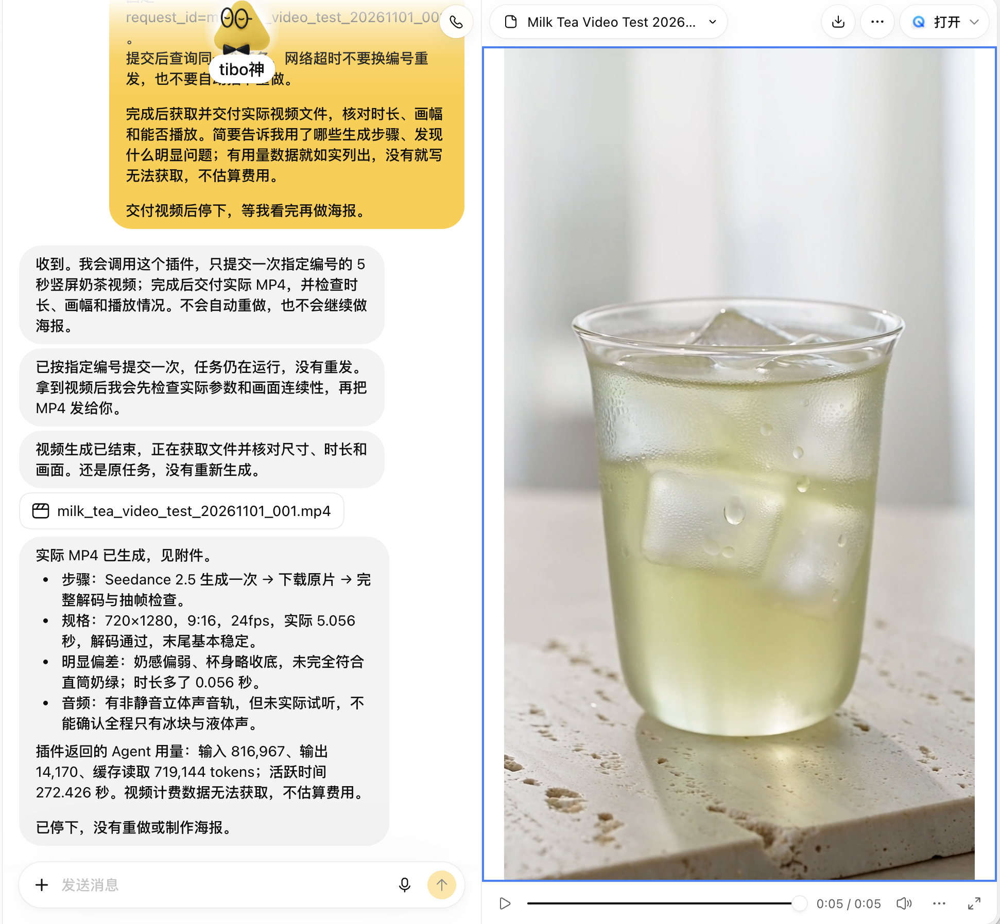

# 一次 5 秒奶茶视频实测

这次案例验证了 Dots → 私有 MCP → 方舟 Managed Agent → 实际 MP4 的交付链路。原任务复查得到 `end_turn`，未发现工具错误；没有为了整理仓库再次生成。

**取得视频不代表所有视觉要求已满足。** 对话回执记录奶感偏弱、杯身略收底，没有完全符合直筒奶绿的需求。

[](../assets/dots-conversation.png)

[](../assets/milk-tea-5s.mp4)

**[实际视频 MP4](../assets/milk-tea-5s.mp4)**。对话截图与 MP4 经提供者授权公开；预览图从该 MP4 的 4 秒处抽帧。

## 文件实测

仓库收录用户交付的 MP4；对话回执说明该文件来自一次 Seedance 2.5 生成后裁剪。生成原片未收录，不能据此独立验证原片参数或裁剪前的视觉表现。

| 项目 | 仓库 MP4 的实际测量 |
|---|---|
| 分辨率 / 画幅 | 720 × 1280 / 9:16 |
| 视频 | H.264，24 fps，121 帧 |
| 视频流时长 | 5.041667 秒 |
| 音频 / 容器时长 | 5.056 秒 |
| 音频 | AAC，32 kHz，双声道 |
| 文件大小 | 5,073,461 字节 |

本轮使用 ffprobe 独立测量以上参数，并用 ffmpeg 完整解码，退出码为 0；对话回执另报告已抽帧检查、末尾基本稳定。音频尚未实际试听，不声称全程只有冰块与液体声。文件 SHA-256 见 [媒体元数据](../assets/media-metadata.json)，展示素材使用说明见 [素材说明](../assets/README.md)。

没有取得完整视频计费明细。截图中的 Agent token 用量、缓存读取与运行时长不等于完整视频账单，不能由此推算固定单价。

## 接入完成后发给 Dots 的测试提示词

以下为可复用示例，不是历史提示词的完整逐字转录。实际运行前需要本人明确授权付费生成，并将编号换为自己的新需求编号。

```text
请使用我已连接的 Seedance Managed Agent 私有插件，只提交一次约 5 秒、9:16、720P 的奶茶视频测试。

画面：无品牌的透明直筒杯，浅绿色奶茶与冰块，奶感明显；杯壁凝结水珠，放在浅色石台上。自然窗光、干净背景，镜头缓慢推近，保持杯型稳定。不加入文字、Logo 或人物。

request_id=milk_tea_demo_001
提交后持续查询同一任务；网络超时不要换编号重发，不要自动重做或继续制作海报。若模型不支持所需时长，先说明，不要悄悄改规格反复生成。

完成后交付实际 MP4。核对尺寸、帧率、实际时长、是否能完整解码和明显画面问题。若裁剪或转码，注明处理步骤。音频没试听就明确写未试听；有计费明细才报告费用，无法获取就如实写明。交付后停下。
```

同一 `request_id` 绑定同一需求；更改提示词的新任务使用新编号。任务提交结果不明时保留原编号，按 [排障说明](troubleshooting.md) 查询，不能用新编号绕过去重。
